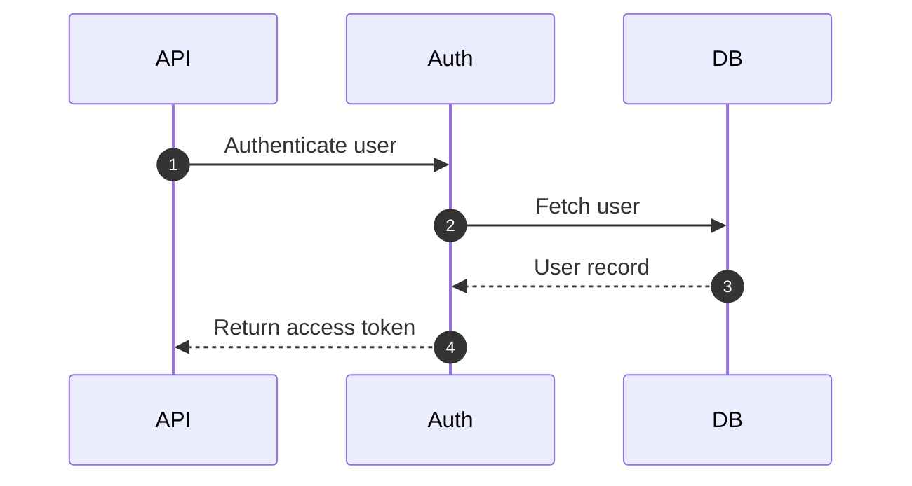

# Markdown design documents

Write the document, and reply to the user, in the user's language: a request in Japanese gets a document with Japanese headings, arrow labels and text. Only the syntax stays as written below: the mermaid keywords, `%% @link-headings`, `%% @ref`, `<!-- link-headings:end -->`, `<details>` / `<summary>`, the front matter keys and `type: design_doc`, `<!-- table: level=… merge=… item=… -->` (the column names in it are the headers of the table, in the user's language: `<!-- table: level=階層 merge=項目名,物理名 -->`), and `<!-- wireframe: … -->` with the `data-item` / `data-ref` attributes of a wireframe.

Follow these rules when you write a design document in Markdown. The document is previewed with the VS Code extension "Markdown Design Doc Viewer". The preview shows a mermaid sequence diagram (or flowchart, ER diagram or state diagram) on the left and the step descriptions after it on the right. Each arrow of the diagram (each node of a flowchart, entity of an ER diagram or state of a state diagram) is linked to the heading with the same text. The goal is that every arrow (node, entity or state) is linked to a heading and every step heading is linked to one of them. A screen design can also show a wireframe of the screen (an HTML file) beside the descriptions of its numbered parts. Edge, relationship and transition labels are not linked, so do not write headings for them.

## Template

````markdown
---
type: design_doc
title: Login Feature Design
version: 1.0
product: <product name>
status: Draft
updated: 2026-10-10
---

# Login Feature Design

<details>
<summary>Change history</summary>

| Version | Date | Changes |
|---|---|---|
| 1.0 | 2026-10-10 | First version |

</details>

## Sequence



## Steps

### 1. Authenticate user

What happens, inputs, validation, errors.

### 2. Fetch user

The query and the conditions under which authentication fails.

### 3. User record

The columns returned.

### 4. Issue token

The token's claims. It expires after 1 hour[^expiry].

<!-- link-headings:end -->

## Next section

[^expiry]: A shorter expiry is preferred, but it stays at 1 hour until refresh tokens are supported.
````

## Sequence diagram

- Write the flow as one ` ```mermaid ` block that starts with `sequenceDiagram`.
- Put `%% @link-headings` on a line of its own inside the block. Without it, the diagram is not shown side by side and nothing is linked.
- Put the diagram at the top level of the document, not inside a list or blockquote.
- Keep each arrow label (the text after `:`) short and unique within the diagram. It becomes the step heading.
- `autonumber` may be used. The preview then shows the arrow's number next to its heading (unless `mdDesignDoc.headingNumbers` is off).
- Other mermaid diagrams (class diagrams, Gantt charts, diagrams without `%% @link-headings`…) are rendered normally. Do not put `%% @ref` in them.

## Flowchart

A flowchart (`flowchart TD` / `graph TD`) can be linked instead of a sequence diagram, with its nodes in place of the arrows. The rules of the step descriptions apply with "node" for "arrow".

- Put `%% @link-headings` on a line of its own inside the block, as for a sequence diagram.
- Give every step node a short label that is unique within the diagram (`A[Validate order]`). The label becomes the step heading. Nodes without a label are not steps.
- Define each step node with its label on a line of its own before writing the edges, so that a `%% @ref <heading text>` on the line just before it applies to that node.
- Use `TD` (top to bottom) for flows with step descriptions. `LR` / `RL` flowcharts are shown above their steps, not beside them.
- Edge labels (`-->|Yes|`) are not linked to headings.

## ER diagram and state diagram

An ER diagram (`erDiagram`) or a state diagram (`stateDiagram-v2`) can be linked the same way, with its entities or states in place of the arrows: for example a heading with the definition of each table after an ER diagram, or a heading with the description of each state after a state diagram. The rules of the step descriptions apply with "entity" or "state" for "arrow".

- Put `%% @link-headings` on a line of its own inside the block, as for a sequence diagram.
- An entity is linked to the heading with its alias (`LINE_ITEM["Line item"]`), or with its name when it has none. A state is linked to the heading with its description (`state "Paid" as S2`), or with its id when it has none. Every entity and every state needs a heading, labeled or not.
- Composite states (`state Fulfillment { … }`) and the states inside them are linked too. `[*]`, forks, joins, choices and notes are not.
- Relationship and transition labels are not linked to headings.
- To link an entity or a state to a heading with another text, define it on a line of its own (`ORDER {` with its attributes, `S2 : Paid`, `state "Paid" as S2`) with `%% @ref <heading text>` on the line just before it.
- Leave out `direction LR` / `RL` when the headings should be beside the diagram. Horizontal diagrams are shown above their headings.

## Wireframe

A screen design can show the wireframe of the screen beside the description of its parts. Write the screen as a static HTML file next to the document, and put it into the document like an image.

```markdown
<!-- wireframe: link-headings width=375 -->
[Sign-in screen](screens/login.html)

<!-- table: item=No merge=Item,Name -->
| No | Item | Name | Type | Required | Description |
|---|---|---|---|---|---|
| 1 | Member ID | `memberId` | Text box | Yes | |
| 2 | Password | `password` | Password box | Yes | |
| 3 | Sign in | `signIn` | Button | | |

### 3. Sign in
```

- Write the HTML as a mock-up: plain elements (`<input>`, `<button>`, `<a>`, lists, tables) and CSS in a `<style>` element or a local style sheet (`<link rel="stylesheet" href="wireframe.css">`). Scripts are not run and external style sheets are not loaded. Local images are relative to the HTML file.
- Number every part described in the document with `data-item="<number>"` on its element, from 1 in the reading order of the screen. Give elements that are one part (the options of a radio button, the rows of a list) the same number.
- Put the wireframe alone in its paragraph, at the top level (not in a list): `[text](file.html)`, ``, or `[](file.html)` with an image of the screen that GitHub shows instead. Write `<!-- wireframe: link-headings -->` on the line right before it to link its parts. Add `width=<pixels>` for a fixed-width screen (`375` for a phone, `1280` for a PC screen), and `stacked` for a wide screen, whose descriptions are then put below it.
- Describe the parts after the wireframe in an item table whose `No` column has the numbers, with `item=No` in its table options, and write a heading numbered like a part (`### 3. Sign in`) for a part that needs more than a row (the processing of a button, the rules of an input). A part may have both a row and a heading. To link a part to a heading without its number, write `data-ref="<heading text>"` on its element.
- Every part needs a row or a heading, and every row of the item table and every heading at the level of the numbered ones needs a part. End the descriptions with `<!-- link-headings:end -->`.
- When the screen exists in a web app that runs (for example a single-page app on its development server), do not imitate it in a mock-up: capture it with `npx markdown-design-doc-viewer capture <url> -o screens/<name>.html --width <pixels>` (see the command line's usage), which writes the page as it is shown with its styles, images and fonts. Capture each state that the description needs (an error message, a dialog) as its own file, after actions such as `--fill '#email=a@example.com' --click 'button[type=submit]' --wait-for '[role=alert]'`. Do not edit the captured HTML: number its parts in the options instead, with `item.<number>="<CSS selector>"` (one per line in the comment: `<!-- wireframe: link-headings width=375` then `item.1="#email"` and `-->` on lines of their own), choosing selectors that will match again when the screen is captured again (an id, a name, a role or a data attribute rather than the classes of a CSS framework). Write the quotes in a selector as `'`. Use the `--width` of the capture as the `width=` of the wireframe. The selectors are not checked in the diagnostics of VS Code: check them with `npx markdown-design-doc-viewer export <document> -o <folder> --strict`, which fails on a selector that matches nothing.

## Step descriptions

- Write the descriptions **after** the diagram, as headings in the order of the arrows, one heading per arrow.
- Use the same heading level for all steps, usually one level below the heading of the section that holds the diagram.
- Make the heading text equal to the arrow label. Whitespace is trimmed and collapsed before comparing, and `<br/>` in a label counts as a space.
- A heading may start with a step number: `### 3. Fetch user` links to the arrow `Fetch user`. If you number the headings, use the arrow numbers given by `autonumber`.
- When the heading has to differ from the arrow label, write `%% @ref <heading text>` on the line just before the arrow, inside the diagram. Several arrows (for example a request and its response) may be linked to the same heading this way.
- Do not add headings at the step level that no arrow links to. They are marked "no arrow" ("no node" for a flowchart, "no entity" for an ER diagram, "no state" for a state diagram). Write extra notes as paragraphs, as lower-level headings, or after the end marker.
- Headings inside lists or blockquotes are not steps.
- After the last step, write `<!-- link-headings:end -->` on a line of its own at the top level. Without it, the description column extends to the next diagram with `%% @link-headings` or to the end of the document.

## Front matter

- Start the design document with YAML front matter that contains `type: design_doc`. The first line of the document is `---`, the metadata follows as `key: value` lines, and a `---` line closes it (the line right after the opening `---` must be a `key: value` line, or the block is not treated as front matter).
- `title`, `version`, `product`, `status` and `updated` are shown in a row as the document's header. Other keys are shown in a table folded below the header (closed by default).
- Also write a `#` heading with the same text as `title` at the start of the body.

## Footnotes

- Write notes that would interrupt the text (reasons, background, history, minor caveats) as footnotes: `[^label]` where the note applies, and the definition `[^label]: note` gathered at the end of the document. Give the label a name that tells what the note is about (`[^expiry]`).
- The preview shows the footnotes at the end of the document, and hovering a reference shows its note in a popup.
- Do not put the specification itself (what happens, validation rules, errors) in footnotes. Write it in the text.
- A heading may have a footnote. Footnote references are ignored when matching headings with arrows.

## Folded sections

- Fold content that does not need to be read every time with `<details>`: for example the change history, alternatives considered and background, long lists (error codes and so on), and long samples (JSON, SQL). Do not fold the main points of the specification.
- Put the change history right after the `#` heading, as a folded table (see the template). Keep its latest version and date the same as `version` and `updated` in the front matter.
- Write `<details>`, `<summary>…</summary>` and `</details>` each on a line of its own at the top level, with a blank line after the `<summary>` line. Without it, the Markdown inside (tables, lists) is not rendered. Also put a blank line before the `</details>` line.
- Do not write headings inside a folded section. They are treated like the headings outside it, and count as steps inside the step descriptions. Use bold text for a subheading.

## Tables of items

For tables of the items of a message, a file or a screen (item name, physical name, type, length…), write an HTML comment with table options on the line right before the table. Elsewhere it stays a plain table.

```markdown
<!-- table: level=Level merge=Item,"Physical name" -->
| No | Level | Item | Physical name | Type | Required | Description |
|---|---|---|---|---|---|---|
| 1 | 1 | Order | `order` | - | Yes | |
| 2 | 2 | Order ID | `orderId` | string | Yes | |
| 3 | 2 | Items | `items` | - | Yes | |
| 4 | 3 | SKU | `sku` | string | Yes | |
```

- `merge=A,B` shows column B under column A, in one cell. Use it for the item name and the physical name. More columns can follow (`merge=A,B,C`), `merge=` can be written more than once (`merge="Min length","Max length"`), and an empty cell adds no line.
- `level=L` takes the integers of column L (1 for the top) as the depth of each row, hides the column and shows the rows as a tree in the column right of it. For nested items (XML elements, JSON objects), add a level column right before the item name instead of describing the parent in the text. With `merge=`, the tree is drawn in the merged cell.
- Write the level of every row as an integer, and make a child one level deeper than its parent. A row more than one level deeper than the row above is also taken as its child, but do not skip levels.
- `item=N` links the rows to the parts of the wireframe before the table with the numbers of column N (see Wireframe).
- Name the columns with the text of their header. Quote a name with spaces or commas (`"Physical name"`).
- Options that cannot be applied (a column that does not exist, a level that is not an integer, a comment not followed by a table) are reported as warnings.

## Other Markdown

- Tables, code blocks with a language (` ```json `, ` ```sql `), GitHub alerts (`> [!NOTE]`, `> [!TIP]`, `> [!IMPORTANT]`, `> [!WARNING]`, `> [!CAUTION]`) and task lists (`- [ ]`, `- [x]`) are rendered.

## Check

When the file is open in VS Code, the extension reports link problems as diagnostics with the source `Markdown Design Doc`: arrows (nodes) without a heading, step headings without an arrow (node), `@ref` targets that do not exist, `%% @link-headings` markers that have no effect, table options that cannot be applied, and the parts of a wireframe without a row or heading (and rows and headings without a part). After writing or editing the document, read the diagnostics of the file and fix the document until none of them remain.

## Check without VS Code

When the diagnostics of VS Code cannot be read, check the document yourself after writing or editing it:

- Every arrow (node) of a diagram with `%% @link-headings` has a step heading with the same text after the diagram, or a `%% @ref` on the line just before it that names one of those headings.
- Every heading at the step level, between the diagram and `<!-- link-headings:end -->`, is linked to an arrow (node).
- Every column named in a `<!-- table: … -->` comment is a header of the table right after it, and the level column has an integer in every row.
- Every part (`data-item`) of a wireframe with `link-headings` has a row with its number in the `item=` column of an item table, a heading numbered like it, or the heading its `data-ref` names, after the wireframe; and every such row and heading has a part.
- If the command line can run (see [Export to HTML](#export-to-html)), export the document with `--strict`. It fails on `@ref` targets that do not exist, markers that have no effect and table options that cannot be applied, but it does not report arrows and headings that are only not linked.

## Export to HTML

When the user asks for HTML (to share, publish or print to PDF), export the documents with the command line of the extension:

```sh
npx markdown-design-doc-viewer export docs/login.md -o out   # out/docs/login.html
npx markdown-design-doc-viewer export docs -o site --index   # every Markdown file under docs/, and site/index.html listing them
```

- Add `--lang ja` for Japanese documents.
- Before running it, read [references/cli.md](references/cli.md) for what it needs (Node.js, Chrome or Chromium, and a font for Japanese), its options, its exit status and an example for GitHub Actions.
