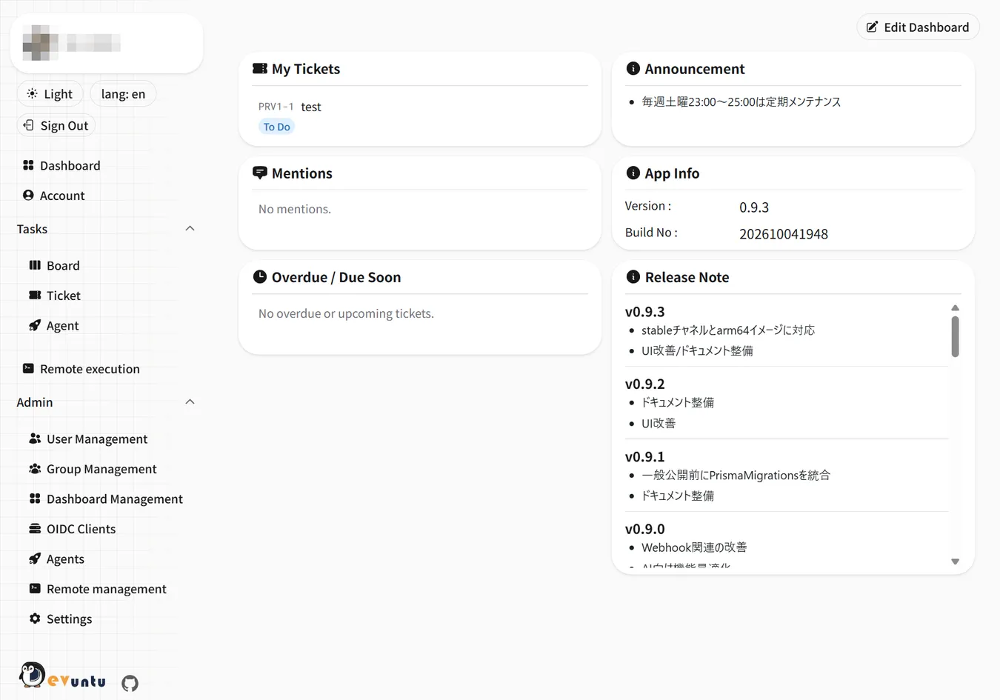

# Devuntu

Self-hosted kanban & ticket management with a built-in MCP server, where AI agents (Claude Code / Codex / OpenCode) work on your tickets and humans approve.

- Source and issues: https://github.com/playree/devuntu
- Website: https://playree.github.io/devuntu/en/
- License: MIT



## Why Devuntu

- **AI agents as assignees**: assign tickets to Claude Code / Codex / OpenCode and they get processed, even while you sleep.
  Plans and reports stay on the ticket, and a human reviews and approves before work moves on
- **Built-in MCP server**: create, update and report on tickets from the AI tools you already use, with your own permissions
- **Self-host with one `compose.yaml`**: runs with Docker Compose and keeps your data on your own server, with no seat limits or fees

Also: GitHub / GitLab integration (PR status, CI results, auto-complete on merge), email / Slack / web push notifications,
Google Calendar and free/busy sharing, remote execution, passkeys and Google sign-in, English / Japanese UI.

## Quick start

Requires Docker Engine 25.0+ and Docker Compose v2.24+, and 2 GB of memory or more (4 GB recommended).

```sh
curl -fsSLO https://raw.githubusercontent.com/playree/devuntu/stable/compose.yaml
docker compose run --rm tools setup-env   # generate the configuration interactively
docker compose up -d --wait
```

Then open `<BETTER_AUTH_URL>/start` in a browser and register the first administrator.
The full steps are in the [README](https://github.com/playree/devuntu/blob/main/README.en.md#quick-start).

## Tags

| Tag         | Contents                                                                     |
| ----------- | ---------------------------------------------------------------------------- |
| `stable`    | A release confirmed to work for a while after it was published (recommended) |
| `latest`    | The newest release                                                           |
| `<version>` | A specific release (e.g. `1.1.4`)                                            |
| `edge`      | A build under test before release                                            |

Images are available for linux/amd64 and linux/arm64.
