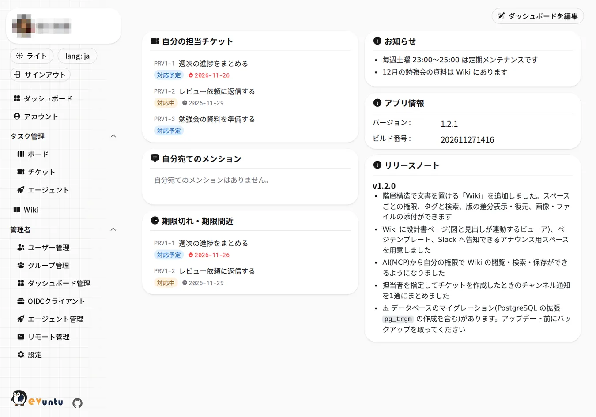
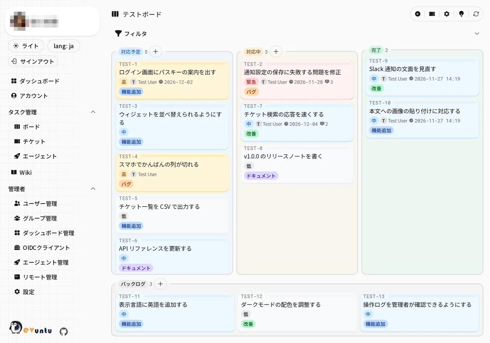
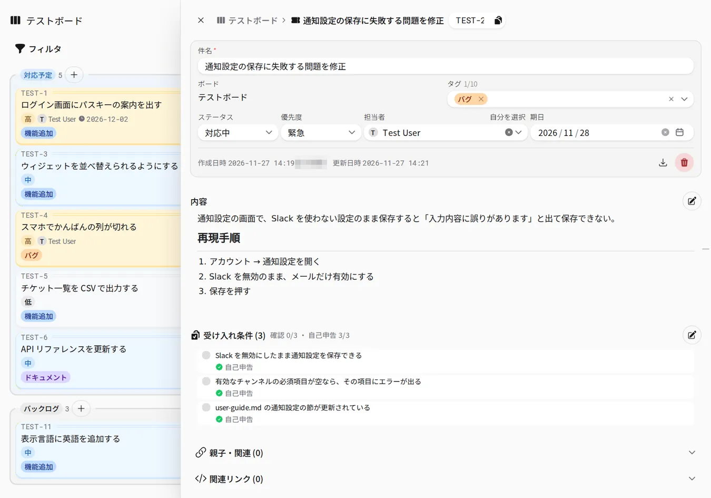
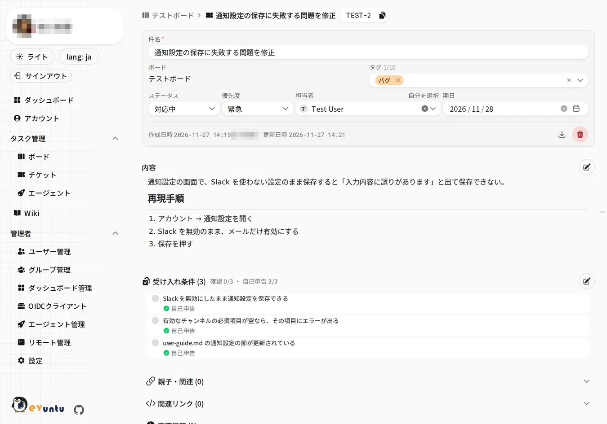
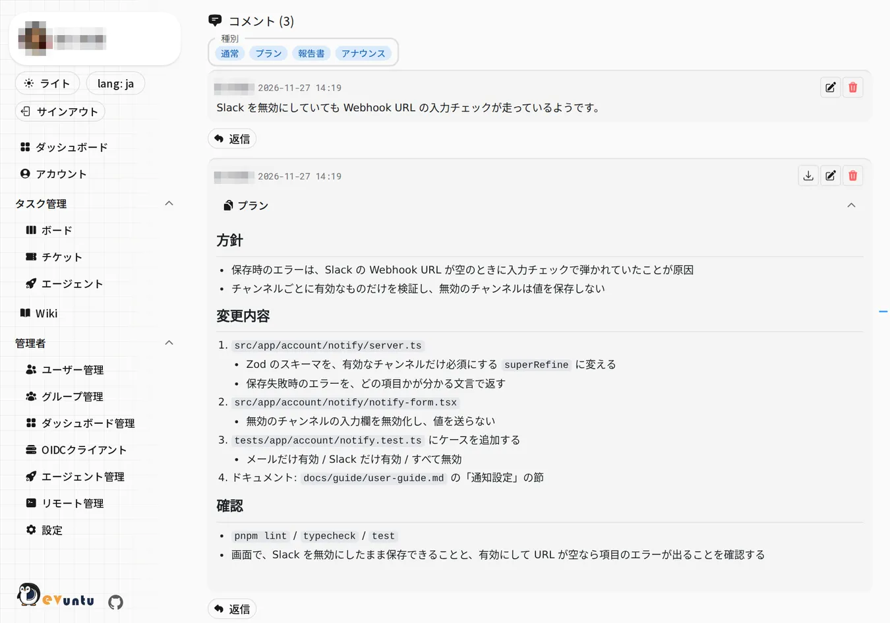
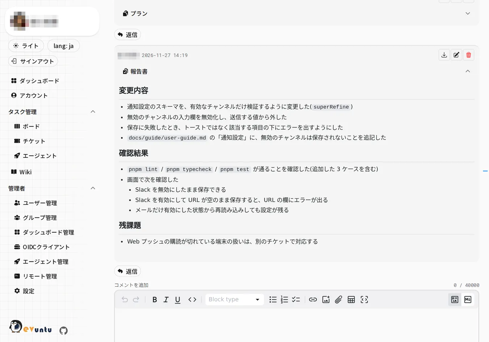
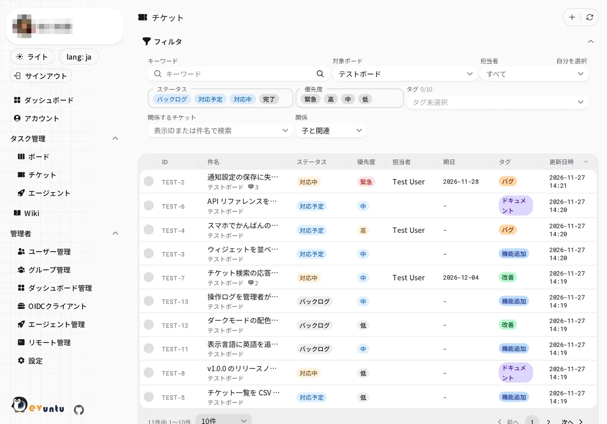
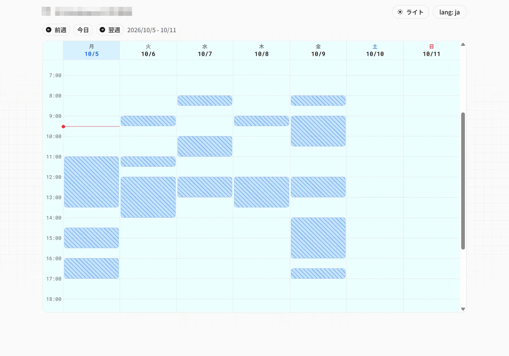

# 利用マニュアル

> **対象**: Devuntu を使う人(チケットを書く人・見る人)
>
> - 画面ごとの使い方を、上から順に並べている。必要な節だけ読めばよい
> - 初めての人は先に [はじめに](getting-started.md) で全体の流れをつかむ
> - AI ツールやAIエージェントとの連携は [ai.md](ai.md) にまとめている

画面のURL(`/boards` など)は、ブラウザのアドレス欄に `<Devuntu の URL>/boards` のように入れると直接開ける。

## サインイン

`/auth/signin` から、次のいずれかでサインインする。どれが使えるかは管理者の設定による。

| 方法                 | 内容                                                                           |
| -------------------- | ------------------------------------------------------------------------------ |
| メールOTP            | パスワード認証が無効な環境。メールアドレスを入力し、届いた認証コードを入力する |
| パスワード           | パスワード認証が有効な環境。メールアドレスとパスワードを入力する               |
| Googleでサインイン   | Google OAuth が構成されている場合                                              |
| パスキーでサインイン | `/account` でパスキーを登録済みの場合                                          |

メールOTPとパスワードは排他で、どちらが使われるかは管理者の設定で決まる。
パスワード認証が有効な環境では、2要素認証の設定を求められることがある。
サインイン後は元のURLへ戻る。

## ダッシュボード

`/` はウィジェットを並べたダッシュボード。表示されるウィジェットは次のとおり。

- 自分の担当チケット(担当が自分で未完了のチケットを、優先度 → 期日の順に上位10件)
- 期限切れ・期限間近(担当が自分で未完了のうち、期限切れと今日から7日以内が期日のもの。期限切れは赤で表示)
- ステータス集計(自分担当のバックログ / 対応予定 / 対応中 と、直近7日に完了した件数。タイルを押すとそのステータスと担当で絞り込んだチケット一覧を開く)
- 自分宛てのメンション(チケット本文とコメントで自分がメンションされたものを新しい順に10件。自分のコメントは除く。押すとそのチケット・コメントを開く)
- 最近更新されたチケット(アクセスできるボードのチケットを更新日時の新しい順に10件。完了も含む)
- アプリ情報 / サーバー情報 / リリースノート(取得元と件数は管理者の設定による。各リリースの要点だけを表示し、続きは「詳細」から GitHub のリリースページで読む。要点は表示言語が日本語なら日本語、それ以外は英語で表示する。英語の要点が無いリリースは日本語で表示する)
- お知らせ(管理者が `/admin/dashboard` で登録)
- リンク(管理者が登録した外部サイトへのショートカット)
- 転送量(管理者が Linode の転送量の取得を設定している環境のみ)
- エージェントの承認待ち(自分が承認者のエージェントが担当で、未完了かつエージェントモードが選択待ちのチケット。件数と上位10件。押すと `/agents` を開く)
- エージェントの実行状況(自分が承認者のエージェントの最近の実行10件と結果。押すと `/agents` を開く)
- 最近のリモート実行(自分が実行したリモート実行の最近10件と結果。押すと実行の詳細を開く)

エージェントの2つは[承認者](ai.md#エージェントの承認)に設定されているユーザー、最近のリモート実行は
[リモート実行](#リモート実行)のメニューが表示されるユーザーだけが選べる。条件を満たさなくなったウィジェットは表示されなくなる。

「ダッシュボードを編集」から、自分の画面の並びを左右のカラムで入れ替えられる。
初期レイアウトは管理者が設定する(未設定の場合は、左が 自分の担当チケット / 自分宛てのメンション / 期限切れ・期限間近、右が お知らせ / アプリ情報 / リリースノート)。



## ボードとかんばん

`/boards` が参加しているボードの一覧。ボードを開くとかんばんになる。
「ボード追加」でチームボードを作れる。作った人がそのボードのオーナーになる。

レーンは **バックログ / 対応予定 / 対応中 / 完了** の4つで、カードをドラッグしてステータスを変更できる。
同じレーン内での並べ替えもドラッグで行う。
完了以外の各レーンの「チケット追加」からは、このボードで、ステータスがそのレーンのチケットを作れる。
カードを選ぶと右からのサイドパネルで詳細が開き、件名のリンクからは単独のページで開く。



画面上部の絞り込みでは、担当者(未割り当てを含む)・優先度・期日・タグを指定できる。
「関係するチケット」に表示IDを指定すると、そのチケットの子・関連チケット(「関係」で子 / 関連 / 子と関連を選ぶ)だけに絞り込める。
候補はこのボードのチケットから表示ID / 件名で探せる。
完了レーンは「完了の表示期間」で指定した期間内に完了したチケットだけを表示する(最大30日。選んだ期間は全ボード共通で保持される)。

「アーカイブ済みも表示」を外している間、アーカイブしたボードは一覧に出ない。
アーカイブしてもチケットは消えない。アーカイブ中のボードは読み取り専用で、チケットの作成・編集・コメントはできない
(アーカイブの解除はボード設定から行える)。

### ボードの種類

| 種類         | 説明                                                                 |
| ------------ | -------------------------------------------------------------------- |
| チーム       | 複数人で共有するボード。メンバーやグループを割り当てる               |
| プライベート | 1ユーザーにつき1つ、自動で用意される個人用ボード。構成は変更できない |

チームボードのメンバーにはオーナーとメンバーのロールがある。
ボードの構成(メンバーなど)を変更できるのはオーナーと管理者。
タグの追加はメンバーもできる(ボード設定の「タグ管理」や、チケットのタグ欄から新しい名前を入れて作る)が、
タグの名前・色の変更と削除はオーナーと管理者だけ。

### ボードキーとチケット表示ID

ボードには大文字英数の**ボードキー**があり、チケットの表示IDは `ボードキー-連番`(例: `ABC-42`)になる。
`/t/ABC-42` でチケットを直接開けるので、チャットやメールで共有するときはこの形式が便利。

ボードキーを変更すると、共有済みの表示IDは元のチケットを指さなくなる。
過去に使われたキーの再利用もできない。

### ボード設定

かんばんの画面上部の歯車ボタンから開き、次を管理する。

- **ボード概要** — 名前、説明、ボードキー
- **ユーザーアサイン** — ユーザー単位の追加とロール(オーナー / メンバー)。プライベートボードには出ない
- **グループアサイン** — グループ単位の割り当て(管理者にだけ表示される)
- **タグ管理** — タグの追加(メンバーも可)・名前と色の変更・削除(オーナーと管理者)
- **チケットテンプレート** — チケット作成画面で選べる雛形(名前・本文・受け入れ条件・タグ・優先度)。1ボード20件まで([テンプレートから作る](#テンプレートから作る))。閲覧はメンバー全員、追加・編集・削除できるのはオーナーと管理者(プライベートボードは所有者だけ)
- **AI向けコンテキスト** — 対象リポジトリ・規約・用語など、このボードのチケットに共通する前提(Markdown。画像は挿入できない)。MCP でチケットやボードを読んだ AI ツールと、チケットを担当するエージェントへ一緒に届く([AI向けコンテキスト](ai.md#ai向けコンテキストとテンプレート))。閲覧はメンバー全員、編集できるのはオーナーと管理者
- **チャネル通知** — このボードの出来事(チケットの作成 / 完了 / 担当変更、AIエージェントの実行結果、マージによる自動完了の保留、アナウンス)を投稿する Slack チャンネルと、通知するイベント(設定できるのはオーナーと管理者。チームボードで、Slack 連携が有効な環境だけに出る)。
  通知先のチャンネルは、そのチャンネルで `/invite @Devuntu` を実行して Bot を招待しないと選択肢に出ない
- **GitHub連携** — 対応付ける GitHub のリポジトリと、プルリクエストのマージでチケットを完了にするか(完了前の受け入れ条件の判定を含む)、エージェントの自動差し戻しとその上限回数(設定できるのはオーナーと管理者。[設定の手順](../admin/git-integration.md))
- **GitLab連携** — 対応付ける GitLab のプロジェクトと、マージリクエストのマージでチケットを完了にするか(完了前の受け入れ条件の判定を含む)、エージェントの自動差し戻しとその上限回数・コメントで差し戻しのきっかけにするユーザー(設定できるのはオーナーと管理者。管理者が GitLab のインスタンスを設定している場合に出る。設定が外れても、残った対応付けを外せるよう表示する。[設定の手順](../admin/git-integration.md))
- **デンジャーゾーン** — アーカイブ、ボードの削除(チケットとコメントもすべて消える。ボードで添付した画像・ファイルも消えるので、ほかのボードに同じURLを貼っていた場合はそちらでも表示されなくなる)。プライベートボードには出ない

### ナレッジとメモリ

かんばん・ボード設定の画面上部の電球ボタンから開く。ボードのメンバーと AI が共有するノートで、
「ナレッジ」(利用者が管理する知識)と「メモリ」(AI が作業中に自動で溜める知見)のタブに分かれる。
AI への渡され方と使い分けは [ナレッジとメモリ](ai.md#ナレッジとメモリ) を参照。

- 一覧は名前・1行の説明・最終更新者と日時。AI が MCP 経由で書いたものには `MCP` が付く。
  キーワード(名前・説明・本文)で絞り込める
- 行を選ぶと本文が開き、編集・ナレッジへの昇格(メモリへ戻す)・削除・履歴を操作できる。
  閲覧はメンバー全員、操作はメンバー(アーカイブ済みのボードでは閲覧だけ)。
  編集を開いた後に他の人が先に保存していた場合は、上書きせずにエラーになる
- 名前は英小文字・数字・ハイフン(例: `deploy-steps`)でボード内で一意。AI はこの名前で読み書きする。
  説明は AI が一覧から選ぶ手がかりになるので、何についてのノートかが1行で分かるように書く
- **履歴** — 版ごとに、誰が(AI か、MCP 経由か)どのチケットの対応中に変えたかと、前の版からの差分を見られる。
  「この版に戻す」で内容を戻せる。戻す前の内容も版として残るので、戻した後でも元に戻せる
- **削除済み** — タブの下で開くと削除したものが並び、履歴の確認と復元ができる(履歴が残っている間だけ)

## チケット

かんばんのカードや `/tickets` の一覧の行を選ぶと、右からのサイドパネルで詳細が開く。
パネルは閉じるボタン・Escape・同じカード(行)をもう一度選ぶ・パネルの外の空いている所を押す、のいずれかで閉じる。
件名のリンクなどからは、単独のページで開く。
詳細の上部の表示IDからは、共有用のURL(`/t/ABC-42` の形)をコピーできる。
チケットの削除は、項目欄の下(作成日時の並び)の削除ボタンから行う(ボードのオーナーかチケットの作成者のみ)。



### チケットの項目

| 項目       | 内容                                                                                   |
| ---------- | -------------------------------------------------------------------------------------- |
| 件名       | 必須                                                                                   |
| 説明       | Markdown([書き方](#markdown-の書き方))。画像の挿入・貼り付けと、ファイルの添付ができる |
| 担当者     | ボードのメンバーから選ぶ。未割り当ても可                                               |
| ステータス | バックログ / 対応予定 / 対応中 / 完了                                                  |
| 優先度     | 緊急 / 高 / 中 / 低                                                                    |
| 期日       | 日付。過ぎると期限切れとして表示される                                                 |
| タグ       | ボードごとに定義したタグを複数付けられる                                               |

チケットが属するボードは作成時に決まり、**後から変更できない**。別のボードへ移したい場合は
移動先で作り直す。

エージェントを担当者にできるボードでは、ここに「エージェントモード」も表示される
([エージェントにチケットを任せる](ai.md#エージェントにチケットを任せる))。

「受け入れ条件」は本文の直下に常に開いた状態で表示される。「親子・関連」「関連リンク」「添付ファイル」「変更履歴」は折りたたみで、
開いた直後は閉じている。見出しに件数が出るので、中身が必要なときに見出しを押して開く。

### 本文の目次

説明に見出し(`#` / `##` / `###`)があると、画面の右端の中ほどに見出しごとの短い線が並ぶ(詳細ページ・サイドパネルの両方。編集中は出ない)。

- 線にマウスを乗せると見出しの一覧に開き、項目を押すとその見出しまでスクロールする。キーボードでは Tab で項目へ移ると開く
- いま読んでいる見出しが線と一覧で強調される
- スマホなどタッチ操作の端末では、右下の目次ボタンから一覧を開く

### ファイルの添付

本文やコメントのエディタのツールバーにある「ファイルを添付」(クリップのボタン)から、ファイルを添付できる。
選んだファイルはカーソルの位置に `[ファイル名](/api/upload/…)` のリンクとして入り、押すとダウンロードされる。

- 形式は問わない。画像を本文中に表示したい場合は、画像の挿入(または貼り付け)を使う
- 1ファイルの上限は既定で 10MB(管理者が変更できる。上限はダイアログに表示される)
- チケット詳細の「添付ファイル」に、本文とコメントに貼られた画像・ファイルの一覧が出る(名前を押すとダウンロード)
- 添付はリンクの記述に紐づく。要らなくなったら本文やコメントからリンクを消す(どこからも参照されなくなった添付は、自動メンテナンスで後日削除される)
- ダウンロードできるのは、そのボードのチケットを見られる人だけ

### Markdown の書き方

チケットの説明・コメント・ナレッジ / メモリなどの本文は Markdown で書く。エディタのツールバーで書式を付けられるほか、
右端の切り替えで Markdown のソースを直接編集できる。ツールバーに無い記法も、ソースで書けば表示に反映される。

| 記法                                   | 書き方                                                                            | 表示                                                                                |
| -------------------------------------- | --------------------------------------------------------------------------------- | ----------------------------------------------------------------------------------- |
| 見出し・太字・リスト・引用・リンクなど | 通常の Markdown                                                                   | そのまま                                                                            |
| 表                                     | GitHub 形式(`\| A \| B \|`)                                                       | 表                                                                                  |
| 参照リンク・脚注                       | `[文字][id]` と `[id]: URL`、`[^1]` と `[^1]: 本文`                               | リンク / 脚注(番号を押すと本文中の定義へ移動)                                       |
| メンション                             | `@` に続けて名前かメールアドレス([コメントとメンション](#コメントとメンション))   | `@表示名`                                                                           |
| コードブロック                         | ` ```ts ` のように言語名を付けて囲む                                              | 言語に応じて色付けされる(言語名が無い・対応していない・5万文字を超える場合は色なし) |
| 図(mermaid)                            | ` ```mermaid ` で囲んで [mermaid](https://mermaid.js.org/) の記法を書く           | シーケンス図・フローチャートなどの図。書き間違いがあるとエラーと元のコードが出る    |
| 注意書き                               | 引用の1行目に `[!NOTE]` / `[!TIP]` / `[!IMPORTANT]` / `[!WARNING]` / `[!CAUTION]` | 種類ごとの色・アイコン・見出し(Note など)付きの枠                                   |

注意書きは GitHub と同じ書き方で、目印は1行目に単独で書き、本文は次の行から続ける。

```md
> [!WARNING]
> 本番のデータは削除しないこと
```

- 図・色付け・注意書きは表示のときだけ反映される。編集中のエディタでは、コードブロックはコードのまま、注意書きは普通の引用のまま表示される
- 印刷 / PDF・HTML 出力([PDF / HTML 出力](#pdf--html-出力))にも、図・色付け・注意書きがそのまま出る

### テンプレートから作る

ボードにチケットテンプレート([ボード設定](#ボード設定))があると、チケット作成画面の右上(閉じるボタンの左)に「テンプレート」の選択が出る
(テンプレートが無いボードでは出ないので、先頭のボードを先に選ぶ)。選ぶと本文・受け入れ条件・タグ・優先度がテンプレートの内容に置き換わり、
そのまま作成前に書き換えられる。

「背景 / やること / やらないこと / 確認方法」のような見出しと受け入れ条件をテンプレートにしておくと、起票の形式がそろい、
AIエージェントがプランを立てやすくなる。MCP で接続した AI ツールからもテンプレートを指定して起票できる
([ai.md](ai.md#ai向けコンテキストとテンプレート))。

### 受け入れ条件

チケット詳細の「受け入れ条件」に、完了の基準を1項目1行で登録できる(チケットを編集できる人のみ。最大20項目)。
チケット作成画面でも、本文の下で同じように入力できる。
見出しの右にある鉛筆のボタンから、項目の追加・削除・並べ替え・文言の変更をまとめて行う。

各項目には2つの確認結果が並ぶ。

| 表示             | 意味                                                                                                                    |
| ---------------- | ----------------------------------------------------------------------------------------------------------------------- |
| チェックボックス | 人の最終確認。チケットを編集できる人がチェックし、2行目の自己申告の後ろに「✓ ◯◯ が確認」と日時が出る                    |
| ✓ / × 自己申告   | AIエージェントの自己申告(✓=充足、×=未充足。未報告なら出ない)。2行目の先頭に出て、マウスオーバーかタップで根拠を表示する |

見出しの横には「確認 x/n ・ 自己申告 y/n」の集計が出る。文言を変えた項目は、どちらの確認結果も未確認に戻る。
エージェントにチケットを任せた場合、受け入れ条件はエージェントに渡り、対応後に各項目の自己チェック結果が報告される。
MCP で接続した AI ツール(Claude Code など)からも同じ自己申告を記録できる([ai.md](ai.md))。



### 親子・関連チケット

チケット詳細の「親子・関連」で、同じボードのチケット同士に関係を持たせられる(チケットを編集できる人のみ)。
「親にする」「子にする」「関連付ける」を選び、相手を表示IDか件名で検索して候補から選んで追加する
(入力前は完了以外で最近更新されたチケットが候補に出る)。表示ID(例: `ABC-12`)や番号だけ(`12`)を直接入力して追加してもよい。
「子チケットを作成」からは、そのチケットを親とする子をその場で作れる。
作成画面のボードは親のボードで固定され、優先度とタグは親の値が初期値として入る(変更可)。作った子は順番の末尾に付く。

| 関係 | 意味                                                                                                             |
| ---- | ---------------------------------------------------------------------------------------------------------------- |
| 親子 | 大きな作業を分けたときの親と子。1つのチケットの親は1つだけで、別の親を設定すると置き換わる                       |
| 関連 | 向きの無い繋がり。どちらのチケットからも見える(例: 「v1.0.0のリリース」に含まれる対応を関連付けて探しやすくする) |

- 子→孫のような多段も作れるが、画面や集計で扱うのは**直下の1階層だけ**(親の親や孫は辿らない)
- 親と子の完了は連動しない。親の詳細とかんばんのカードには、直下の子の進み具合(完了数 / 子の数)が出る。
  未完了の子が残っていても、親を完了にするときの確認は出ない
- 子には順番(`#1` など)があり、子の一覧の上へ / 下へのボタンで並べ替えられる(押すたびに保存される)。
  同じ順番の子は並行して進められる(MCP やエージェントの起票案で付けられる)
- 子がある親には「次へ進む条件」(前の順番が完了したら / 前の順番が報告済みになったら)がある。
  エージェントに任せた子は、前の順番の兄弟がこの条件を満たすまで処理されない([タスクの分割](ai.md#タスクの分割))
- 親・子・関連のうち、1件も無いものは見出しごと表示されない。一覧の行は表示IDと件名がリンクになっている
- かんばんのカードには、子の進み具合と、子であれば親の表示IDが出る
- 子と関連の見出しの「一覧で見る」から、チケット一覧をその条件で開ける
- チケットを削除すると、そのチケットの関係も消える(子は親なしになる)

### コメントとメンション

チケットにはコメントを投稿できる。種別は4つ。

| 種別       | 用途                                                                                    |
| ---------- | --------------------------------------------------------------------------------------- |
| 通常       | 普通のコメント                                                                          |
| プラン     | 対応方針の提示。主にエージェントが使う                                                  |
| 報告書     | 対応結果の報告。主にエージェントが使う                                                  |
| アナウンス | ボードメンバーへの告知(リリースのお知らせなど)。ボードのチャネル通知で Slack へも流れる |

種別は送信ボタンのメニューで選び、「プランとして送信」「報告書として送信」のように送る。一覧は種別で絞り込める。
プラン / 報告書は折りたたんで、アナウンスは開いた状態で表示する。

アナウンスは、ボード設定の「チャネル通知」で「アナウンス」を ON にしていると、通知先の Slack チャンネルへ
本文ごと投稿される(改行・箇条書き・リンクの URL を残し、2000 文字までに切り詰める)。投稿した後に編集しても、もう一度は流れない。
送信後の表示で、Slack へ送る通知として受け付けたかが分かる(通知先が無いボードでは、チケットに記録だけが残る。受け付けた後に通知先の設定を外すと、Slack へは届かない)。
AI エージェントのプラン / 報告書の後にアナウンスしても返信とはみなさないので、承認・差し戻しのボタンはそのまま残る。
AI はアナウンスを提案するだけで、投稿するかは利用者が決める([ai.md](ai.md#アナウンス))。

<p>
  
  
</p>

- コメントには1階層だけ返信できる(返信への返信はできない)
- 自分のコメントは編集できる。削除できるのは、自分のコメントか、チケットを削除できる人
  - 返信はコメントと一緒に消える。そのため、他の人の返信(承認・差し戻しを含む)が付いたコメントは、自分のものでもチケットを削除できる人でなければ削除できない
- コメントの投稿・返信はチケットを編集できる人のみ

本文・コメントのどちらでも `@` に続けて名前かメールアドレスを入力すると、候補からメンションできる。
メンションされた相手には通知が飛ぶ([通知](#通知))。

### 関連リンク(ブランチ・PR・コミット)

チケット詳細の「関連リンク」に、GitHub / GitLab のブランチ / プルリクエスト(マージリクエスト) / コミットの URL を貼って紐付けられる
(チケットを編集できる人のみ)。AIエージェントや MCP クライアントからも同じように紐付けられる。
GitLab は管理者が設定したインスタンスの URL だけを受け付ける。

ボード設定の「GitHub連携」/「GitLab連携」でリポジトリを対応付けると、次が自動で反映される
(対応付けと Webhook の登録はボードのオーナーか管理者が行う。手順は [git-integration.md](../admin/git-integration.md))。

- プルリクエスト(マージリクエスト)のタイトルと状態(オープン / ドラフト / マージ済み / クローズ)
- CI の結果(実行中 / 成功 / 失敗 / キャンセル)
- ブランチ名の先頭にそのボードの表示IDがあるプルリクエストの自動紐付け(例: `feature/ABC-12`、`ABC-12-fix`)。
  `feature/add-ABC-12` のように途中にあるものは拾わない。自動で付いたリンクを外すと、付け直されることは無い。
  フォークからのプルリクエストは自動では紐付かないので、必要なら手動で紐付ける

ボードの設定によっては、プルリクエストのマージでチケットが自動で完了になったり、CI の失敗やレビュー指摘で
エージェントへ自動で差し戻されたりする([連携のオプション](../admin/git-integration.md#連携のオプション))。
マージで完了にする設定でも、未達の受け入れ条件が残っているチケットは完了にならず、変更履歴と通知で保留したことが分かる。
リリースのタグ打ちのようにマージ後に残る作業は受け入れ条件に入れておき、済んだら手動で完了にする。
自動差し戻しの回数は、チケット詳細の処理状態の横に出る。

### 変更履歴

チケット詳細の「変更履歴」に、いつ・誰が・何を変えたかが新しい順で表示される(直近100件)。
画面・MCP・AIエージェントのどこから変えても、同じように記録される。

| 記録する項目               | 表示する内容                                                         |
| -------------------------- | -------------------------------------------------------------------- |
| 作成                       | 作成した人と日時                                                     |
| ステータス                 | 変更前 → 変更後(マージによる自動完了は変更者が「PR / MR のマージ」)  |
| 担当者・タグ               | 変更前 → 変更後の名前                                                |
| 優先度・期日               | 変更前 → 変更後                                                      |
| 件名・内容                 | 変更前 → 変更後(内容は先頭100文字の抜粋)                             |
| 受け入れ条件               | 消した項目(取り消し線)と足した項目。文言の修正は両方に出る           |
| マージによる自動完了の保留 | 保留のきっかけになったプルリクエストと、その時点で未達の受け入れ条件 |

- 同じ値を保存し直しただけの項目や、受け入れ条件の並べ替えだけの変更は記録しない
- 受け入れ条件のチェック・エージェントの自己申告、コメントの投稿は記録しない(それぞれの欄で確認できる)
- 変更した人が退会すると「名前なし」と表示される
- 保持期間(既定365日)を過ぎた履歴は自動で消える([operations.md](../admin/operations.md#自動メンテナンス))

### PDF / HTML 出力

チケット全体、またはプラン/報告書/アナウンスの 1 件を PDF または HTML ファイルにできる。
Wiki のページも同じ仕組みで出力できる(Markdown も選べる。[Wiki の出力](#出力pdf--html--markdown)を参照)。

| 出力するもの                 | ボタンの場所                         | 含まれる内容                                                                                            |
| ---------------------------- | ------------------------------------ | ------------------------------------------------------------------------------------------------------- |
| チケット全体                 | 項目欄の下(作成日時の並び)の「出力」 | 項目・タグ・内容・受け入れ条件・親子/関連・関連リンク・すべてのコメント(返信を含む)。変更履歴は含まない |
| プラン / 報告書 / アナウンス | そのコメントの右上の「出力」         | そのコメントの本文(件名・表示ID・投稿者・日時を添える)。通常のコメントにはボタンが出ない                |

「出力」ボタンを押すと「PDF出力(印刷)」「HTML出力」を選ぶメニューが開く。どちらも本文と画像の読み込みを待ってから次の処理になる。待つのは最大 10 秒で、それまでに読み込み終わらない画像があってもそのまま進む。

- **PDF出力(印刷)**: 印刷用のページが別タブで開き、印刷ダイアログが開く。送信先(プリンター)で「PDFに保存」を選んで保存する。ダイアログを閉じた後は、ページ上部の「印刷 / PDFに保存」から開き直せる
- **HTML出力**: 別タブは開かず、その場で HTML ファイルがダウンロードされる(作っている間は「出力」ボタンが読み込み中の表示になる。数秒かかることがある)。中身は印刷用のページと同じで、画像とスタイルを埋め込んだ 1 ファイルなので、ログインしていない環境やオフラインでもそのまま開ける
  - 取得できなかった画像は埋め込まれず元の URL のまま残るため、ログインしていない環境やオフラインでは表示されない
  - 添付ファイルは埋め込まれない(一覧に名前とサイズが出る。リンク先を開くにはログインが必要)
  - フォントは埋め込まないため、開いた環境のフォントで表示される

ファイル名の初期値は `表示ID 件名`(プラン / 報告書は `表示ID プラン` など)。
画面をダークテーマにしていても、印刷用のページと HTML は白地で出る。

### 一覧から探す

`/tickets` はアクセスできるすべてのボードのチケットを横断して表示する。
キーワード、ボード、ステータス、優先度、担当者、タグで絞り込める(タグは対象のボードを選んでから指定する)。
件名・ステータス・優先度・担当者・期日・更新日時の列で並べ替えられ、既定は更新日時の新しい順(表示IDとタグでは並べ替えられない)。
「関係するチケット」でチケットを選ぶと、そのチケットの直下の子 / 関連チケット / その両方に絞り込める。
入力欄に触れると最近更新されたチケットが候補に出て、表示IDや件名で探せる(対象ボードを選んでいればそのボードの中から)。
表示IDを直接入れて Enter でも絞り込める。
検索結果には表示件数の上限がある。



## Wiki

ボードとは別に、階層を持つ文書を置く場所。サイドメニューの「Wiki」から開く。
文書は**スペース**ごとにまとまり、スペースの中にページを親子で並べる(10階層まで)。

インストール直後(Wiki を含む版へ更新した直後も)には、サンプルのスペース「サンプル」(キー `SAMPLE`)がある。
Wiki の使い方・Markdown の書き方のページと、[設計書](#設計書ページ)の例(シーケンス図・ER 図・電文定義・状態遷移図)が入っている。

- 公開範囲は「全員」なので、ログインできる人なら誰でも読める。メンバーは割り当てられていないので、編集するには管理者がスペースの設定で編集者や owner を割り当てる
- 不要になったら、スペースの設定からアーカイブする。中身ごと要らなければ[削除](#スペースの削除)もできる

### スペースの作成と公開範囲

`/wiki` の「+」からスペースを作る。ログインできる人なら誰でも作れ、作った人がそのスペースの owner になる。

- **スペースキー** — 先頭が英字の大文字英数 2〜8 文字(例: `DOCS`)。ページは `キー/番号`(例: `DOCS/12`)で指定でき、ページ詳細のヘッダからコピーできる。
  改名や移動では変わらないが、キーは作成後に変更できない。削除したスペースのキーも、別のスペースでは使えない
- **公開範囲** — 「割り当てのみ」は割り当てられた人だけが見られる。「全員」はログインできる全員が閲覧でき、編集できるのは割り当てられた編集者以上
- **区分** — 「混合」は通常のページと[設計書](#設計書ページ)を混ぜて置ける。「設計書」は設計書だけを置く[設計書スペース](#設計書スペース)になる。
  「アナウンス」はお知らせを新しい順に並べる[アナウンス用スペース](#アナウンス用スペース)になる。
  作成後もスペースの設定で変えられるが、通常のページや種類が通常の[テンプレート](#テンプレート)があるスペースは「設計書」にできない(削除するか、種類を設計書に変えてから切り替える)。
  子ページを持つページ、設計書ページ、種類が設計書のテンプレートがあるスペースは「アナウンス」にできない(子ページをスペース直下へ移し、設計書を削除するか通常のページに変えてから切り替える)

### ロールと割り当て

スペースの設定(歯車ボタン)の「ユーザーアサイン」「グループアサイン」「ボードアサイン」で、ユーザー・グループ・ボードを割り当てる。複数の経路で割り当てられた場合は、最も強いロールになる。

- **閲覧者** — 読むだけ
- **編集者** — ページの作成・編集・移動・削除
- **owner** — 設定(名前・説明・公開範囲・区分・割り当て・タグ・[テンプレート](#テンプレート)・アーカイブ)の変更と、スペースの削除もできる。ユーザーへの直接の割り当てでだけ選べ、1人以上必要

ボードを割り当てると、そのボードのメンバー(直接・グループ経由)が選んだロールでスペースを使える。割り当てられるのは自分が参加している、アーカイブしていないチームボード(管理者は参加していないものも含めてすべて)。
管理者は割り当てが無くても設定を変更できるが、ページは読めない。

アーカイブしたスペースは閲覧のみになり、一覧の既定の表示から外れる(「アーカイブ済みも表示」で出せる)。

### スペースの削除

スペースの設定の「デンジャーゾーン」の「削除」で、スペースを丸ごと削除する。できるのは owner と管理者で、アーカイブ中のスペースも削除できる。

- スペース内のページ・版・タグ・テンプレート・割り当て・添付(画像・ファイル)もすべて削除され、元に戻せない
- このスペースの添付を、チケットや別のスペースの本文に貼っていた場合も、その添付は見えなくなる
- スペースへのリンクや `キー/番号` の指定は開けなくなる。削除したスペースのキーは、同じ指定が別のページを指さないよう、新しいスペースでは使えない

### ページの作成と編集

- **作成** — スペースのトップやツリーの「ページを作成」でスペース直下に、ページ詳細の「子ページを作成」でそのページの下に作る。タイトルと[種類](#設計書ページ)を入れると、そのページの本文の編集から始まる。
  スペースに[テンプレート](#テンプレート)があれば、作成画面で選んでタイトル・種類・本文を埋めて作れる
- **編集** — タイトルの横の更新者・日時(版の選択)の右の鉛筆ボタンで、タイトル・種類・本文(Markdown)を編集する。チケットと同じく、画像の挿入・貼り付けと[ファイルの添付](#ファイルの添付)ができる。
  保存ボタンの左の欄に、任意で**コミットメッセージ**(変更の要約。200文字まで)を書ける。書いたメッセージは[履歴](#履歴と復元)の版に出る。
  編集中は **Ctrl+S**(macOS は **Cmd+S**)でも保存できる(保存ボタンを押せないときは保存されず、ブラウザの「ページを保存」も開かない)
  - **下書きの保護** — タイトル・種類・本文・タグのどれかを変えた後にキャンセルすると、破棄してよいか確認が出る。
    同じく、ツリー・パンくず・子ページ・タグ・サイドメニューのリンクや、スペースの切り替え・子ページの作成で画面を移る前にも確認が出る。
    タブを閉じる・再読み込みでは、ブラウザの離脱の警告が出る。ブラウザの戻る/進むでは確認されない
  - **保存の競合** — 編集を始めた後に他の人が保存していた場合は保存できず、下書きを残したまま選択肢が出る。
    「最新を別タブで開く」で他の人の変更を確かめる、「下書きをコピー」で本文(Markdown)をクリップボードに控える、「上書き保存」で確認のうえ下書きの内容で保存する(他の人が保存した版は履歴に残る)。
    閉じると編集に戻る
- **移動** — 「ページを移動」で、移動先の親(スペース直下か別のページ)と兄弟の中での位置を選ぶ。自分自身や子孫の下には移せない。
  開いた時点では今の親と位置が選ばれていて、親も位置も変えなければ移動できない。
  「◯◯ の後」を選んだときは、画面を開いた後に同じ親の下のページが増減していても ◯◯ の直後に入る。◯◯ が他の人に移動・削除されていると移動されず、通知とともにツリーが更新される。
  ツリーの上下の並べ替えは、画面を開いた後に他の人がそのページを別の親へ移した・同じ親の下のページを増減や並べ替えしていると行われず、通知とともにツリーが更新される。
  移動・並べ替えは[履歴](#履歴と復元)に移動の版として残り、版の選択には移動した人と日時が出る。
  ページの更新日時(検索の並び順・出力の見出し)は内容の保存でだけ変わるので、編集中のページが移動・並べ替えされても保存は競合にならない
- **削除** — ページ詳細の上部の「ページを削除」で削除する(過去の版の表示中に出る「この版を削除」は版だけを消す)。子ページを持つページは、削除される件数を確認したうえで配下ごと削除する。
  画面を開いた後に他の人が配下のページを増やした・減らした・入れ替えていた場合は削除されず、通知とともにツリーが更新される(もう一度削除すると新しい件数で確認が出る)

ページ詳細には、パンくず(スペース › 先祖 › ページ)と目次、子ページの一覧が出る。

ページに添付した画像・ファイルは、そのスペースを閲覧できる人だけが開ける(公開範囲が「全員」ならログインできる全員)。
本文から消した添付も、ページの版が残っている間は残り、版が保持期間を過ぎて消えた後の自動メンテナンスで削除される。

### 設計書ページ

ページの**種類**を「設計書」にすると、本文を [Markdown Design Doc Viewer](https://github.com/playree/markdown-design-doc-viewer) の形式の設計書として表示する。
`%% @link-headings` を付けた mermaid のシーケンス図・フローチャート・ER 図・状態遷移図と、その後の見出しが矢印(ノード)ごとに結び付き、図の横に手順が並ぶ。
front matter の `type: design_doc` は設計書ヘッダ(タイトル・版数・ステータスなど)になり、項目の表(電文定義など)や目次も VS Code 拡張と同じ見た目で出る。
書き方は Markdown Design Doc Viewer の README(「Writing linked documents」)を参照。
AI に書かせる場合は、Devuntu の MCP から入れられる markdown-design-doc スキルを使う([AIとの連携](ai.md#wiki-を-ai-から使う))。

- **種類の決め方** — 作成時に「通常 / 設計書」を選ぶ。既存のページは、編集中にタイトルの横の「種類」で切り替えて保存する(版にも残り、版を戻すと種類も戻る)
  - 通常から設計書にすると、本文に front matter が無ければ最小のもの(`type: design_doc` とタイトル)を先頭に足す
  - 設計書から通常に戻すと、本文をリッチエディタで開き直すため、front matter や HTML コメントなどの書き方が変わることがある(確認が出る)
  - 判定は種類だけで決まり、本文に front matter を書いただけでは設計書にならない(MCP で種類を省いて新しく作るときを除く。[AIとの連携](ai.md#wiki-を-ai-から使う)を参照)
- **表示** — 幅の制限を外して画面いっぱいに出す。図と手順は、本文の幅がおよそ 900px 以上のとき横に並び、狭い画面では図の下に手順が続く。目次はビューアの右端に出る。
  図の矢印を押すと結び付いた見出しへ移り、見出しにマウスを乗せると矢印が強調される
- **編集** — 本文をそのまま(ソースで)編集する。front matter や HTML コメントは書いたとおりに保存される
  - 広い画面では左にソース、右にプレビュー。プレビューをダブルクリックするとソースの該当行へ移り、ソースのカーソル行はプレビューで強調される
  - 狭い画面(スマホなど)では「ソース / プレビュー」のタブで切り替える
  - 画像は貼り付け・ドロップで添付し、その位置に `` が入る。アップロード中は仮の印(HTML コメント)が入り、終わるまで保存と種類の切り替えはできない
- **できないこと** — ワイヤーフレームの別ファイル(HTML)は読み込まない。メンション・チケット参照など Devuntu 独自の記法は、設計書ページでは通常の文字として出る
- **本文の HTML の制限** — 本文に書いた HTML が画面のほかの部分に効かないよう、次のものは除かれる(表示・版の比較・編集のプレビュー・PDF / HTML 出力のすべて)
  - `<style>`・`<link>`・`<meta>`・`<base>`、フォーム(`<form>`・`<input>`・`<button>`・`<textarea>`・`<select>`)、イメージマップ(`<map>`・`<area>`)、`<dialog>`
  - `style` 属性(表のセルの揃えだけは残る)と、`class` 属性(ビューアが付けるもの以外)。`id` には `sn-` が付く(`#id` へのリンクはそのまま使える)

### 設計書スペース

区分を「設計書」にしたスペースでは、作れるページは設計書だけになる。

- ページの作成で種類は選ばず、設計書として作る。編集中の「種類」も出ない
- 通常のページだった版には戻せない(ロールバックのボタンも、削除済みのページの復元のボタンも押せない)。押せない理由は、過去の版の注記と削除済みのページの行に出る
- スペースのトップには、ページの一覧の代わりに **設計書一覧** が出る。Markdown Design Doc Viewer(VS Code 拡張・CLI・デスクトップアプリ)の設計書一覧と同じ表で、
  - 親ページごとに表が分かれる(見出しは `親/子/` のような親ページのタイトルのパス。スペース直下のページは見出し無しの表)。
    タイトルの `/` は全角の `／` で出し、同じパスになる親ページが複数あれば、2つ目以降は末尾に `(#番号)` を付けて分ける
  - 列はタイトル・番号(ページの `キー/番号` の番号)と、front matter の `version`(版数)・`product`(プロダクト)・`status`(ステータス)・`updated`(更新日)のうち、どれかのページが持つもの
  - 上の入力欄でタイトル・番号・メタ情報を絞り込め、列の見出しを押すと並べ替わる(昇順 → 降順 → 元の順)
  - タイトルを押すとそのページへ移る

### アナウンス用スペース

区分を「アナウンス」にしたスペースは、お知らせを置いて後から探せるようにする場所。Slack に流すと埋もれてしまう連絡を、ここに残しておく。

- ページは通常のページだけで、親子を持たない。並びは作成日時の新しい順で決まり、並べ替えや移動はできない(ページ詳細の「子ページを作成」「ページを移動」も出ない)
- スペースのトップには、新しい順の一覧を出す。各行はタイトル・タグ・作成者・作成日時で、件数が多ければページを分けて出す(表示件数は下で選べる)。
  上のタグの選択で、そのタグを持つアナウンスに絞り込める
- **バックナンバー** — 年月ごとの件数を出す(広い画面では一覧の右、狭い画面では一覧の下)。月を押すとその月、年を押すとその年のアナウンスだけになり、「すべての期間」で戻る。
  年月は見ている人のタイムゾーンで区切る。タグで絞り込んでいる間は、件数もそのタグのアナウンスだけを数える。絞り込みは URL に残るので、そのまま共有できる
- サイドメニューには、ツリーの代わりに最新の10件と「バックナンバー」へのリンクを出す
- 「新しいアナウンス」で作る。[テンプレート](#テンプレート)を用意しておくと、定型のお知らせを日付入りのタイトルで作れる
- 削除したアナウンスを復元すると、元の作成日時の位置に戻る

#### Slack への通知

アナウンスは、スペースに設定した Slack チャンネルへ知らせられる。保存しただけでは通知せず、ページの「通知」から送る。
個人宛て(メール / Slack DM / Web プッシュ)には送らない。

- **通知先の設定** — スペースのオーナーか管理者が、スペース設定の「Slack 通知」でチャンネルを選ぶ(選べるのは Bot が参加しているチャンネルだけ)。
  「通知しない」にすると解除できる。公開範囲が「割り当てられた人のみ」のスペースでも、件名と抜粋はチャンネルの全員に見える
- **送り方** — editor 以上がページ詳細の「通知」(メガホン)から送る。
  - 種類: 「初回のお知らせ」か「更新のお知らせ」。Slack の文面が「〜さんがアナウンスを公開しました / 更新しました」と分かれる。一度送ったページでは「更新のお知らせ」が既定になる
  - 一言: 任意(2000文字まで)。空なら本文の先頭を送る
  - 送るタイミング: 「今すぐ」か「日時を指定」(15分刻み。自分のタイムゾーンで指定し、1年先まで。15分刻みでない時刻は受け付けない)
- Slack には、件名 `[キー/番号] タイトル`・一言(または本文の先頭)・ページを開くボタンが載る
- **予約** — 送る前なら、ページ下の「通知の履歴」から変更・取り消しができる。変更した人が送信者になる。
  予約は1分ごとに確認され、時刻を過ぎたものから、そのときの最新のタイトルと本文で送る。
  多くは時刻の1分ほど後に届くが、同じ人の通知が短い間に集中したときや、サーバーの通知の処理を止めている間は、次の確認以降に遅れて送られる。
  そのときにスペースがアーカイブされている・アナウンス用でなくなった・通知先が未設定・Slack 連携が無効・送信者が編集できなくなった・ページが削除された場合は、送らずに「見送り」になる(履歴に理由が出る)
- **履歴とバッジ** — ページの下に通知の履歴(予約中 / 送信済み / 取り消し / 見送り)が出る。
  「送信済み」は Devuntu が送信を受け付けたことを表し、その直後に通知先を外した場合や、Bot がチャンネルから外されていて投稿に失敗した場合も「送信済み」のまま残る。
  スペースのトップの一覧には「未通知 / 予約中 / 通知済み」、サイドメニューの最新10件にはその状態のアイコンが出る。
  履歴とバッジは editor 以上にだけ見える

### ツリー

サイドメニューの「Wiki」から Wiki を開いている間は、サイドメニューに「メニュー / Wiki」のタブが出る。タブを押すと中身が左右にスライドして切り替わる。
「Wiki」タブには、スペース一覧の画面では閲覧できるスペース(アーカイブ済みを除く)が並び、スペースの中ではツリーが出て、ツリーでページを選べる。
ツリーの上のスペース名を押すと、閲覧できるスペースの一覧が出て、選んだスペースのトップへ切り替えられる(今のスペースを選べばそのトップへ、「すべてのスペース」でスペース一覧へ移る)。
開いているページは強調され、その先祖の枝と、子を持つならそのページ自身の枝も自動で開く(開いたページ自身の枝を閉じた場合は、ほかのページへ移るまで閉じたまま)。
スマホではツリーのページを選ぶとメニューが閉じる。スマホ幅では、行と開閉・並べ替えのボタンを指で押しやすい大きさで出す。

編集者以上は、ツリー上部の「並べ替え」ボタンで並べ替えモードにすると、各ページに上下の移動と「移動」のボタンが出る。
ページにタグがあれば、タイトルの右にタグの色の点が出る(名前はマウスを乗せると出る)。

### タグ

タグはスペースごとに持つ。スペースの設定の「タグ管理」で作成・編集(名前・色・表示順)・削除する。
タグの作成は編集者以上ならでき、ページの編集中にタグ欄へ新しい名前を入れても作れる。編集・削除は owner と管理者だけができる。
アーカイブしたスペースでは、タグの作成・編集・削除はできない。

ページのタグは、本文と同じく鉛筆ボタンの編集で付け外しする(1ページ10個まで)。
付けたタグはページ詳細のタイトルの横と子ページの一覧に出る。タグを押すと、そのタグを持つページをスペース内で探せる。

### テンプレート

ページを作るときの雛形(タイトル・種類・本文)。スペースごとに持ち、スペースの設定の「テンプレート」で owner と管理者が追加・編集・削除・並べ替え(上下のボタン)をする。
1スペース20件まで。アーカイブしたスペースでは変更できない。

- **名前** — 作成画面の選択肢に出る名前(スペース内で重複不可、40文字まで)。MCP からもこの名前で指定する
- **タイトルの雛形** — 空なら、選んでもタイトルの入力はそのまま
- **種類** — 通常 / 設計書。設計書スペースでは設計書だけ。本文は種類に合わせ、通常はリッチエディタ、設計書はソースとプレビューで編集する(画像も貼れる)
- **プレースホルダー** — タイトルと本文の次の書き方は、ページを作るときに置き換わる
  - `{{date}}` — 作成日(`YYYY-MM-DD`)
  - `{{month}}` — 作成月(`YYYY-MM`)
  - `{{user}}` — 作成者の表示名

  日付は作成者のアカウント設定のタイムゾーン(未設定ならサーバーの既定)で決まる

編集者以上がページの作成画面で「テンプレート」を選ぶと、タイトル(置き換えた後のもの)と種類が入り、種類はテンプレートのもので固定される。
作成すると、本文がテンプレートの内容(置き換えた後のもの)のページができ、そのまま本文の編集から始まる。タイトルは作成前に変えられる。
作ったページとテンプレートは紐付かないので、後からテンプレートを変えても作成済みのページは変わらない。
MCP で接続した AI ツールからも、テンプレートの名前を指定してページを作れる([AIとの連携](ai.md#wiki-を-ai-から使う))。

### 履歴と復元

ページ詳細のタイトルの横の「〇〇 が 日時 に更新」を押すと、そのページの版の一覧が開く。
版ごとに、版数(`v1`, `v2` …)、誰が(AI か、MCP 経由か)いつ保存したか、どのチケットの対応中に変えたか、コミットメッセージが分かる。
チケットは、見ている人が閲覧できるものだけ表示 ID が出る(プライベートボードのチケットなどは出ない)。
版数はページごとの通し番号で、古い版が消えても振り直さない。復元の版には、戻し元の版数(`v3 から` など)が出る。

過去の版を選ぶと、ページ詳細のタイトル・タグ・本文がその版の時点の内容に切り替わり、過去の版を表示中である旨が出る(設計書の版は設計書として表示する)。
タグは、その版の後で改名したものは今の名前で出て、削除したものは(同じ名前のタグを作り直していても)出ない。一覧で先頭の「最新」を選ぶと、いまの内容の表示に戻る。過去の版を表示している間は編集できない。

- **連続保存のまとめ** — 同じ人が続けて保存した分は、最初の保存から10分以内なら1つの版にまとまる(時刻は最後に保存した時刻)。
  作成・移動・削除・復元と、コミットメッセージを付けた保存はまとめない。コミットメッセージの付いた版に、後の保存がまとまることもない
- **差分** — 過去の版を表示中に版の選択の右の「差分」を押すと、その版から最新までの変更を表示する(閲覧者も使える)。もう一度押すか、一覧で「最新」を選ぶと元の表示に戻る。
  差分を出したまま別の過去の版を選ぶと、その版からの差分に切り替わる。表示の形は最新の版の種類で決まる。タイトル・種類・タグが変わっていれば、本文の差分の上に変更前 → 変更後で出る(タグの改名だけでは変更として出ない。削除したタグは版の時点の名前に「(削除済み)」を付けて出る)
  - 通常のページは、本文を行単位で比べ、追加した行を緑、消した行を赤の取り消し線で出す。変更から離れた行は件数だけにまとめる
  - 設計書は、最新の内容に変更の印を付けて出す(VS Code 拡張の Git の版との比較と同じ)。追加・変更・削除したブロックを色分けし、変更したブロックでは変わった語を示し、変更した図の下に変更前の図を折りたたんで出す。
    下部の差分バーに変更の件数と、変更の間を移動するボタンが出る。バーの × で差分を閉じる
- **戻す** — 編集者以上は、過去の版を表示中に版の選択の右の戻すボタン(この版に戻す)で、タイトル・種類・本文・タグをその版の内容に戻せる。ページの位置(親・並び)は変わらないので、必要なら「ページを移動」で動かす。
  戻したこと自体も新しい版(復元)として残るので、戻す前の内容にもまた戻せる。その版の後で改名したタグは今の名前で付き、削除したタグは(同じ名前のタグを作り直していても)付かない
- **版の削除** — スペースの owner と管理者(スペースを閲覧できる場合)は、過去の版を表示中に版の操作の並びの「この版を削除」ボタンで、その版を履歴から消せる。消した版は元に戻せない。
  最新の版(いまの内容)とアーカイブ済みのスペースの版は消せない。編集者は、内容を戻せなくならないよう版を消せない
- **戻せる期間** — 版は最後の保存から7日残る。それより古い版も、いまの内容の版と直近の2版は残るので、しばらく編集していないページでも最近の変更を戻せる。
  また、7日より古い版のうち最新の1版も残るので、保持期間より前の時点へ戻せる(7日より古い版には「保持期間より前」の印が付く)。
  ただし1ページに残る版は新しい50版までで、これを超えた古い版は上の版も含めて消える。7日のうちに何度も保存したページでは、保持期間より前の時点へは戻せなくなる。
  日数・直近に残す版数(既定2)・版数の上限は管理者が変更できる

**削除したページ**は、スペースのトップのごみ箱のボタン(削除済みのページ)から復元できる。削除前の版は、復元したページの履歴で見られる。

- 復元できるのは削除から7日のあいだだけ
- 一覧は元の親の下に子を字下げして並ぶ。いちばん外側の行には元の親(「元の親: 親 › 子」のようなパンくず、元からスペース直下ならそのこと)が出る
- 復元したページは元の親ページの下の元の位置に戻る。次の場合はスペース直下に戻る
  - 親ページが無い(削除されたまま、または履歴が消えた)。親が削除されたままのときは、確認でそのことを知らせる。
    元の親の下へ戻したいときは、先に親を復元してから戻す(スペース直下に戻った後なら、親を復元してからページを移動する)
  - 元の親の下では階層の上限(10階層)を超える(削除後に元の親が深い位置へ移動したときなど。親を先に復元しても同じ)。
    移動でも同じ上限がかかるので、元の親の下へ戻したいときは、元の親(またはその先祖)を浅い位置へ移して上限に収めてから、ページを移動する
- 一覧の上から順に復元すれば親が先に戻るので、配下ごと削除したページも(上の場合を除き)元の親子関係に戻る。
  配下のある行の「配下ごと」で、そのページと配下をまとめて親から順に復元できる(途中で失敗したらそこで止まり、戻した分はそのまま残る)。
  設計書スペースでは、通常のページとその配下は「配下ごと」でも復元しない(確認でその数を知らせる)
- 一覧を開いた後に別の人が復元したページは、上書きせずにそのままにする
- 復元してもモーダルは閉じず、続けて別のページを復元できる。復元した行のボタンからそのページを開ける
- 番号(`キー/番号`)は削除前と同じ
- 作成者・作成日時も削除前のまま(作成の版が保持期間や版の数の上限で消えていれば、残っている最も古い版の人・日時)。更新者・更新日時は復元した人・時刻になる

### 出力(PDF / HTML / Markdown)

ページ詳細の版の選択の右の「出力」ボタン(閲覧者にも出る。編集中は出ない)から、表示中のページを PDF / HTML / Markdown ファイルにできる。
過去の版を表示していれば、その版の内容が出る(見出しとファイル名に版数が付く)。子ページは含まない。

- **PDF出力(印刷) / HTML出力** — チケットと同じく、PDF は印刷用のページが別タブで開いて印刷ダイアログが開き、HTML はその場でファイルがダウンロードされる(流れと制約は[PDF / HTML 出力](#pdf--html-出力)を参照)。
  見出しにはページの指定(`キー/番号`)・スペース名とパンくず・タイトル・版数(過去の版のとき)・更新者と日時・タグが出る(設計書ページの HTML は除く。下を参照)。
  設計書ページの PDF は目次を出さず、図と項目の表を縦に並べて全体を出す(画面のスクロールの範囲で切れない)
- **HTML出力(設計書ページ)** — 設計書ページの HTML は、上の見出しを付けず、本文だけを Markdown 設計書ビューアの HTML エクスポート(VS Code 拡張・コマンドライン)と同じ形の 1 ファイルにする。
  開くと、目次・図と処理概要の横並び・矢印と見出しのハイライトがそのまま使え、印刷すると縦並びになる。画像は埋め込む(取得できなかった画像は Devuntu の URL のまま残る)。Wiki のページや添付へのリンクは Devuntu の絶対 URL にする
- **Markdown出力** — 本文を `.md` ファイルとしてその場で保存する。通常のページは先頭にタイトルの見出し(`# タイトル`。過去の版は `# タイトル (v3)` など)を付け、設計書ページは本文のまま(先頭の設計書ヘッダにタイトルを持つ)出す。
  本文に貼った画像・ファイルの URL は、Devuntu の絶対 URL(`https://<ホスト>/api/upload/...`)に書き換える。画像は埋め込まないので、開いて表示するには Devuntu にログインしている必要がある

ファイル名の初期値は `キー-番号 タイトル`(過去の版は `キー-番号 タイトル (v3)` など)。

### 検索

- **横断検索** — `/wiki` の検索欄で、閲覧できるすべてのスペース(アーカイブ済みを除く)からページを探す。結果はスペースの一覧の代わりに出る
- **スペース内検索** — ツリーの上の検索欄、またはタグを押して開く。アーカイブ済みのスペースでも探せ、タグで絞り込める(選んだタグのどれかを持つページ)

キーワードは空白で区切ると、すべての語を満たすページだけが出る(5語まで)。
1つの語は、タイトルか本文に含まれるか、タグ名と一致(大文字小文字は区別しない)すれば満たす。全角の英数字は半角として扱う。

並び順は、すべての語がタイトルに含まれるページが先で、その中と残りはそれぞれ更新日時の新しい順。
各結果には、パンくず・タグ・本文の一致した箇所の前後・更新日時が出る。件数は一覧の上に出る。表示は最大50件まで(上限に達したときの件数は「50件以上」)。

検索には索引(3文字ずつの並びで引く方式)を使っている。**2文字以下の語は索引で引けないため、ほかに3文字以上の語が無いと全ページを順に調べることになり**、ページが多いと時間がかかる。
「設計 DB」のように3文字以上の語と組み合わせれば、短い語は3文字以上の語で絞ったページの中だけで調べる。

### AI から使う

AI ツール(MCP)やエージェントからも、ページの検索・閲覧・編集ができる。ボードに割り当てたスペースは、そのボードのチケットに対応する AI へ伝わる。
詳しくは [AIとの連携](ai.md#wiki-を-ai-から使う) を参照。

## カレンダーと空き時間の共有

`/cal` は、Google カレンダーの空き時間を外部の人と共有するための設定画面(共有タイトル・共有URL・再発行・無効化と、予定の追加登録)。
予定そのものはこの画面には出ず、共有URLの公開ページで週ごとに表示される。
**Googleアカウント連携が前提**で、未連携の場合は連携を促す案内が出る。
管理者が Google 連携を有効にしていない環境や、許可グループに入っていないユーザーは使えない(サイドメニューにも出ない)。

「空き時間の共有」を有効にすると、共有URL(`/cal/[id]`)が発行される。共有URLでは、週単位で前後の週へ移動して空き状況を見られる(今週の 4 週前から 12 週後まで)。



- **共有URLは認証不要の公開ページ**。URLを知っていれば誰でも空き状況を見られる
- 見えるのは「予定あり」の時間帯だけで、予定の件名や詳細は公開されない
- 共有タイトルを設定できる
- URLを再発行すると以前のURLは無効になる。共有をやめるときは無効化する

共有を有効にすると「予定の追加登録」が使えるようになり、毎週固定の予定(曜日と時間帯)を登録できる。
定例会議など、Google カレンダーに入れていない時間を空き時間から除きたいときに使う
(共有を有効にする前は表示されない)。

## 通知

次のイベントを **メール** / **Slack DM** / **Web プッシュ**で受け取れる。

- **メンション** — チケット本文やコメントで `@` メンションされたとき
- **担当者の変更** — チケットの担当者に指定されたとき
- **AIエージェントの実行結果** — 自分が作成したチケットの処理が終わったとき(プランへの返信や報告の確認が必要かも分かる)
- **マージによる自動完了の保留** — 担当しているチケット(担当がエージェントか未割り当てなら、自分が作成したチケット)が、未達の受け入れ条件のためマージで完了にならなかったとき
- **期日のリマインド** — 担当しているチケット(担当がエージェントか未割り当てなら、自分が作成したチケット)の期日が明日・今日になったとき。
  期日の前日と当日に1回ずつ、自分のタイムゾーン(`/account` で設定)の 9:00 を過ぎたら届く。完了したチケットとアーカイブしたボードのチケットには届かない。
  期日を変えると、変えた後の期日で改めて届く(9:00 を過ぎてから期日を今日・明日にした場合は、数分のうちに届く)

メールは5分ごとに区切り、その間の通知をまとめて1通で送る(最大5分遅れて届く)。
`/account` の「通知設定」で、イベント種別 × チャネルごとに ON/OFF を切り替えられる。
Slack 通知を受け取るには、管理者による Slack 連携の有効化と、自分の Slack アカウント連携の両方が必要
(Slack 側のメールアドレスが Devuntu のものと一致している必要がある。管理者が許可グループを指定している場合は、そのグループのユーザーだけが使える)。
Web プッシュは端末ごとの登録が必要なので、通知を受け取りたい端末で「通知設定」内の「Webプッシュ通知」から登録する
(iPhone / iPad は iOS / iPadOS 16.4 以降で、ホーム画面に追加したアプリから開いた場合のみ受け取れる。Safari のタブからは登録できない)。

チームボードでは、チケットの作成・完了・担当者の変更・エージェントの実行結果・マージによる自動完了の保留・アナウンスを Slack チャンネルへ
流せる(設定はボードのオーナーか管理者がボード設定の「チャネル通知」で行う。通知先のチャンネルには Bot の招待が必要)。
Wiki のアナウンス用スペースのページも、スペースに設定した Slack チャンネルへ通知できる([Slack への通知](#slack-への通知))。

Slack に貼ったチケットURLは、閲覧権限を確認したうえでカード表示に展開される
(プライベートボードのチケットは展開しない)。
管理者向けの設定は [notifications.md](../admin/notifications.md) を参照。

## アカウント設定

`/account` で次を設定する。

- **アバター** — サインイン時に連携元の画像がコピーされる。独自の画像を設定すると以降はコピーされない
- **タイムゾーン** — 日時の表示に使われる
- **パスキー** — パスキーの登録・削除。パスキーでのサインインに使う
- **Googleアカウント** — 連携・解除(カレンダー機能の前提)。管理者が Google 連携を有効にし、許可グループで自分が対象になっている場合のみ表示
- **Slack** — 連携・解除(Slack 通知の前提)。管理者が Slack 連携を有効にし、許可グループで自分が対象になっている場合のみ表示
- **許可済みアプリ** — MCPクライアントなどに与えたアクセスの確認と取り消し
- **MCPトークン** — AI ツールから MCP へ接続するための長期トークンの発行・削除(最大10本)。
  発行時に有効期限(30 / 90 / 180 / 365日、または無期限)を選ぶ。発行後に、トークンと Claude Code / Codex CLI / OpenCode の登録コマンドが表示される
  (トークンはこのときだけ表示される。[ai.md](ai.md#aiツールからつなぐmcp))
- **通知設定** — 通知のイベント種別 × チャネル別 ON/OFF と、「Webプッシュ通知」での端末の登録・解除
  (Webプッシュの端末を1台も登録していない間や、Slack 連携が使えない環境では、そのチャネルのチェックボックスが無効になり、マウスオーバーで理由が出る)

テーマ(ライト / ダーク)と表示言語は、サイドメニューの上部で切り替えられる。

サイドメニューの幅は、画面幅が 1024px 以上のとき、メニューの右端の境界をドラッグして変えられる
(境界にフォーカスして ←/→ キーでも変えられる。ダブルクリックで元の幅に戻る)。
変えた幅はブラウザに保存され、次からも同じ幅で表示される。

## リモート実行

管理者が用意した処理を `/commands` から実行できる。デプロイやバッチの再実行など、
これまで担当者に依頼していた作業を自分で回すための画面。
**メニューに出るのは、自分がターゲットにアサインされている場合だけ**。

コマンドはターゲット(接続先のサーバー)ごとに折りたためるセクションにまとまっている
(最初はすべて開いた状態)。実行できるのは、そのターゲットにアサインされている人だけ。
アサインは管理者が行う([権限](../admin/command-exec.md#権限))。
ターゲットにはメンバーとオーナーのロールがあり、オーナーは実行に加えてコマンドの定義を画面から編集できる。

1. `/commands` で実行したいコマンドの「実行」を押す
2. 入力欄を埋める。ほとんどは選択肢から選ぶ形で、選べる値は管理者が定義したものだけ。
   文字を直接書く欄が出ることもあるが、そこにも**使える文字と長さの制限がある**
   (使えない文字を入れるとその場で赤くなる)
3. 実行する(実行前の確認が設定されたコマンドでは、確認ダイアログで内容を確かめてから実行する)
4. 実行の詳細画面へ移り、出力が流れてくる

出力は実行中もそのまま流れる。画面を閉じても実行は続き、`/commands/runs` の履歴から開き直せば
途中からでも最後まで見られる。実行中の画面では「中断」で止められる。
中断や時間切れのあと、出力の末尾に「リモート側の処理が止まったことを確認できませんでした」と出た場合は、
接続先で処理が続いている可能性がある。次を実行する前に管理者へ確認する。

カードの右下にある時計のボタンを押すと、**そのコマンドだけに絞り込んだ履歴**が開く。
絞り込みは履歴画面の上に出る名前の「×」で解除できる。

取り返しのつかないコマンドでは、ログインからしばらく経っていると再認証を求められることがある。

| 状態     | 意味                                      |
| -------- | ----------------------------------------- |
| 順番待ち | 受け付けたが、まだ動き出していない        |
| 実行中   | 動いている                                |
| 成功     | 終了コード 0 で終わった                   |
| 失敗     | 非0で終わった、または接続や時間切れで中断 |
| 中断     | 画面から止めた                            |

「このコマンドは既に実行中です」と出る場合は、同じコマンドを同時に動かせない設定になっている。終わるのを待ってから実行し直す。
履歴に出るのは自分の実行だけで、他の人の実行は見えない(管理者は履歴の「全員の実行」で全員分を見られる)。

### コマンドの定義を画面から編集する(オーナー)

定義ファイルに `editable` が設定されているターゲットでは、オーナーがコマンドの追加・編集・削除を
`/commands` の歯車ボタン(ターゲット設定)から行える。編集はコマンド 1 件ぶんの YAML を書く形で、
保存時に検証される。**接続先(ホスト・ユーザー・鍵)は画面からは変えられない。**

検証は**書いている最中にも走る**。打鍵が止まると YAML の構文と内容の両方を見て、
問題のある行に印が付く(印にカーソルを合わせるか、行頭の印をタップすると理由が出る)。
まだ書かれていない必須項目は警告、書いた内容が間違っているものはエラーとして区別する。
保存はエラーが残っていても試せる。ファイルをまたぐID重複や編集権限のように、サーバーでしか分からない問題は保存時に返る。

- ログインから時間が経っていると、追加・編集ボタンを押した時点で再認証を求められる。認証後に元の画面へ戻ってから書き始める
- 画面から保存すると、コマンドの定義の中に書かれていたコメントは消える。残したい説明は `description` へ書く
- 編集の導線が出ない場合は、自分がオーナーでないか、そのターゲットが編集を許可されていないか、
  定義ディレクトリが書き込みできない状態になっている(管理者向けの設定は
  [command-exec.md](../admin/command-exec.md#画面から編集する)を参照)
- 保存時に「他の人が編集しました」と出た場合は、読み込んだ後に別の経路でファイルが
  変わっている。再読み込みしてからやり直す

## AIとの連携

自分の AI ツール(Claude Code / Codex CLI / OpenCode など)からチケットを読み書きしたり、
AIエージェントを担当者にしてチケットを任せたりできる。使い方は [ai.md](ai.md) にまとめている。

- [AIツールからつなぐ(MCP)](ai.md#aiツールからつなぐmcp)
- [エージェントにチケットを任せる](ai.md#エージェントにチケットを任せる)
- [エージェントの承認](ai.md#エージェントの承認)

管理者だけが使う画面(`/admin/**`)は [運用者向けドキュメント](../admin/README.md#管理者の画面) を参照。
